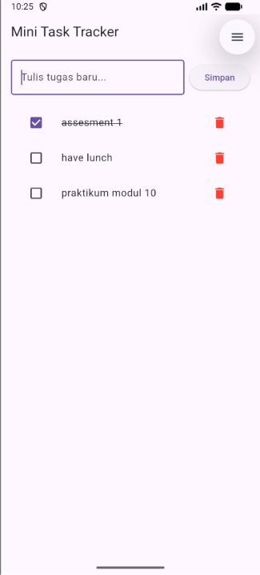

# Mini Task Tracker

Aplikasi catatan tugas harian (*To-Do List*) sederhana satu halaman yang dibuat menggunakan Flutter dan Dart.

## Fitur Utama
- **Tambah Tugas:** Memasukkan judul tugas baru melalui kolom input dan menyimpannya ke dalam daftar.
- **Tandai Selesai:** Mengubah status tugas menggunakan *Checkbox* dengan efek teks tercoret.
- **Hapus Tugas:** Menghapus item tugas dari daftar secara langsung.

## Tampilan Aplikasi

